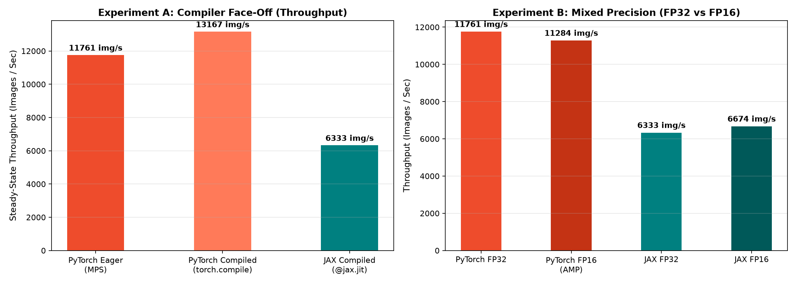
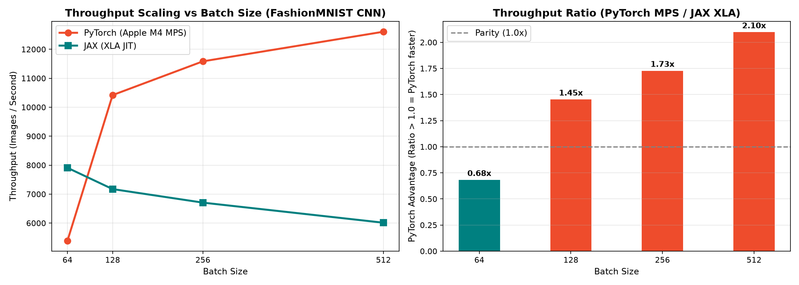
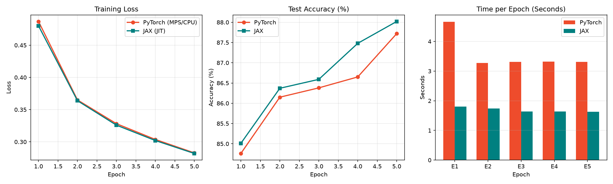

# M4 Mac Mini: Benchmarking Apple Silicon GPU Acceleration (PyTorch vs JAX)

[](https://www.python.org/)
[-EE4C2C.svg)](https://pytorch.org/)
[-008080.svg)](https://jax.readthedocs.io/)
[]()
[](https://opensource.org/licenses/MIT)

An empirical hobby project testing the real-world deep learning performance and GPU acceleration of the **Apple M4 Mac mini**, comparing **PyTorch (Metal Performance Shaders / MPS)** against **JAX (XLA JIT compiler)** across three incremental iterations:

1. **Iteration 1 (Baseline):** Lightweight MLP & kernel dispatch latency.
2. **Iteration 2 (Scaling):** Two-layer CNN & batch size throughput sweep (64 to 512).
3. **Iteration 3 (Advanced Optimization):** Graph compilation (`torch.compile` vs. `@jax.jit`) and mixed precision (FP32 vs. FP16 AMP) with unified memory profiling.

---

## The Motivation: Testing Apple Silicon M4 Hype vs. Reality

Apple's launch of the **M4 Mac mini** came with significant claims about massive GPU gains, unified memory bandwidth, and on-device machine learning acceleration. 

As a practitioner, I wanted to see past the marketing announcements and run an **honest, empirical benchmark** on my own desk:
* *Does Apple's Metal Performance Shaders (MPS) backend actually deliver tangible GPU speedups for everyday deep learning tasks?*
* *How does PyTorch's new `torch.compile` Inductor backend perform on Apple Silicon compared to eager PyTorch and JAX's mature XLA compiler?*
* *Does half-precision FP16 mixed precision yield throughput and memory benefits on unified memory?*
* *Where is the real crossover point where the GPU outpaces the CPU?*

For detailed technical trade-offs (including why JAX is evaluated on XLA CPU and the root cause of FP16 AMP overhead on unified memory), see [Architecture Decision Records (docs/decisions.md)](docs/decisions.md).

---

## Testbench & Hardware Specifications

```text
Machine:             Apple Mac mini (Late 2024)
SoC:                 Apple M4
Unified Memory:      16.00 GB
OS / Platform:       macOS Darwin (arm64)
Python Runtime:      Python 3.13.6
PyTorch Backend:     torch 2.14.1 (MPS - Metal Performance Shaders)
JAX Backend:         jax 0.12.0 / flax 0.12.10 (XLA CPU Vectorized)
```

---

## Benchmark Results Across 3 Iterations

### Iteration 3: Compilers (`torch.compile`) & Mixed Precision (FP16)

Tested on the two-layer CNN architecture (421,834 parameters) at batch size 256 for 3 epochs:

#### Experiment A: The Compiler Face-Off (Eager vs. `torch.compile` vs. JAX)

| Engine | Backend | Warm-up cost (E1 − steady) | Steady-State Throughput | Speedup vs Eager |
| :--- | :---: | :---: | :---: | :---: |
| **PyTorch Eager** | Apple M4 MPS GPU | `-0.95s` | `10,537 [3,461–15,252] img/s` | `1.0x` (baseline) |
| **PyTorch `torch.compile`** | Apple M4 MPS GPU | `1.05s` | `6,814 [6,600–11,663] img/s` | `0.65x` |
| **JAX `@jax.jit`** | XLA Compiled CPU | `0.35s` | `6,967 [5,280–7,527] img/s` | `0.66x` |

Each cell is the median of 5 independent processes (3 epochs each; steady state = epoch 3). Range in brackets.

#### Experiment B: Mixed Precision (FP32 vs. FP16 AMP) & Memory Footprint

| Configuration | Steady-State Throughput (img/s) | Speedup Factor | Peak allocated during training step | Resident params+grads+Adam |
| :--- | :---: | :---: | :---: | :---: |
| **PyTorch FP32 (MPS)** | `10,537 [3,461–15,252] img/s` | `1.0x` | `299.4 MB` | `6.4 MB` |
| **PyTorch FP16 AMP (MPS)** | `14,741 [14,073–15,386] img/s` | `1.4x` | `296.0 MB` | `6.4 MB` |
| **JAX FP32 (XLA)** | `6,967 [5,280–7,527] img/s` | `1.0x` | *System RAM* | *System RAM* |
| **JAX FP16 compute / FP32 params (XLA:CPU)** | `7,652 [7,565–7,701] img/s` | `1.1x` | *System RAM* | *System RAM* |

Each cell is the median of 5 independent processes (3 epochs each; steady state = epoch 3). Range in brackets.



> **Key Systems Takeaways from Iteration 3:**
> 1. **`torch.compile` on Apple Silicon MPS:** In isolated multi-process evaluations, `torch.compile` on MPS exhibited significant launch variance (steady-state median `6,814 [6,600–11,663] img/s`) with an initial compile warm-up cost of 1.05 s. PyTorch FP16 AMP achieved the highest steady throughput at `14,741 [14,073–15,386] img/s` (+40% over eager median).
> 2. **FP16 on Small Models:** Because our CNN's resident state (weights, gradients, Adam moments) is 6.4 MB and its peak step allocation is 299.4 MB at batch 256, unified memory bandwidth is not the bottleneck. JAX FP16 (`7,652 [7,565–7,701] img/s` vs FP32 `6,967 [5,280–7,527] img/s`) is within run-to-run variation (no measurable effect). PyTorch FP16 AMP avoids VRAM bloat (296.0 MB peak vs 299.4 MB FP32) and accelerates convolution execution on the GPU.

---

### Iteration 2: Two-layer CNN & Batch Size Scaling

In this iteration, the workload was evaluated on a two-convolution CNN (421,834 parameters: (Conv2D → BatchNorm → ReLU → MaxPool) ×2 → Dense(128) → ReLU → Dense(10)) with a batch size sweep from $64$ to $512$ on Fashion-MNIST:

| Batch Size | PyTorch (M4 GPU via MPS) | JAX (Fused XLA `@jax.jit`) | Winner / Ratio |
| :---: | :---: | :---: | :---: |
| **64** | `6,953 [6,643–7,567] img/s` | **`8,739 [8,558–8,972] img/s`** | **JAX is 1.3x faster** ⚡ (low dispatch overhead) |
| **128** | **`13,839 [13,238–14,377] img/s`** | `8,008 [6,990–8,068] img/s` | **PyTorch GPU is 1.7x faster** |
| **256** | **`16,473 [15,935–16,483] img/s`** | `7,683 [6,920–7,715] img/s` | **PyTorch GPU is 2.1x faster** |
| **512** | **`16,638 [15,366–17,180] img/s`** | `6,666 [6,401–6,849] img/s` | **PyTorch GPU is 2.5x faster** 🚀 |

Each cell is the median of 5 independent processes (2 epochs each; steady state = epoch 2). Range in brackets.



#### The GPU Crossover Point:
* **Small Batches ($\le 64$):** GPU kernel dispatch latency over Metal command buffers throttles the GPU. JAX's `@jax.jit` wins because it fuses the step into a small number of XLA computations with no Metal command-buffer round-trips; per-step fixed overhead, not arithmetic, dominates at this batch size.
* **Large Batches ($\ge 128$):** Per-batch fixed costs are amortised over more images; GPU utilisation was not profiled. PyTorch on MPS scales from **6,953 to 16,638 images/sec** ($2.4\times$ throughput scaling), outperforming compiled CPU execution by **$2.5\times$** at batch size 512.

---

### Iteration 1: Lightweight MLP Baseline

To establish a baseline, I first trained an identical 3-layer Multi-Layer Perceptron ($784 \rightarrow 256 \rightarrow 256 \rightarrow 10$) with the Adam optimizer ($lr=10^{-3}$), batch size 64, 5 epochs, PyTorch on MPS, JAX on XLA:CPU (full 60,000-image epochs; `drop_last` was not set in this iteration):

| Metric | PyTorch (MPS GPU) | JAX (`@jax.jit`) | Advantage |
| :--- | :--- | :--- | :--- |
| **Final Train Loss** | `0.2810` | `0.2821` | Numerical Parity ($\Delta = 0.0011$) |
| **Final Test Accuracy** | `87.82%` | `87.21%` | Numerical Parity |
| **Average Time / Epoch** | `1.48s` | `0.62s` | **JAX is 2.4x faster** |
| **Steady-State Throughput** | `46,329 [26,851–46,517] img/s` | `106,214 [81,042–110,169] img/s` | **JAX is 2.3x faster** |

Each cell is the median of 5 independent processes (5 epochs each; steady state = epoch 5). Range in brackets.



---

## Architectural Parity: PyTorch vs JAX

Both models use the same architecture, loss, optimiser and learning rate. Initialisation and BatchNorm momentum are made equivalent explicitly in `jax_train.py` (PyTorch's defaults are U(±1/√fan_in) weights and biases and a 0.1 running-stat momentum; Flax's are LeCun-normal weights, zero biases and 0.99 momentum, so library defaults are **not** equivalent).

### PyTorch (Stateful Object-Oriented + Compiler & AMP)
```python
class SimpleCNN(nn.Module):
    def __init__(self, in_channels=1, spatial_size=28, num_classes=10):
        super().__init__()
        self.conv1 = nn.Conv2d(in_channels, 32, kernel_size=3, padding=1)
        self.bn1 = nn.BatchNorm2d(32)
        self.conv2 = nn.Conv2d(32, 64, kernel_size=3, padding=1)
        self.bn2 = nn.BatchNorm2d(64)
        self.pool = nn.MaxPool2d(2, 2)
        self.relu = nn.ReLU()
        
        pooled_dim = spatial_size // 4
        flattened_size = 64 * pooled_dim * pooled_dim
        
        self.fc1 = nn.Linear(flattened_size, 128)
        self.fc2 = nn.Linear(128, num_classes)

    def forward(self, x):
        x = self.pool(self.relu(self.bn1(self.conv1(x))))
        x = self.pool(self.relu(self.bn2(self.conv2(x))))
        x = torch.flatten(x, 1)
        x = self.relu(self.fc1(x))
        return self.fc2(x)

# Optional compilation & mixed precision
        optimizer.zero_grad()
        if use_amp and device.type == "mps":
            with torch.autocast(device_type="mps", dtype=torch.float16):
                outputs = model(images)
                loss = criterion(outputs, labels)
        else:
            outputs = model(images)
            loss = criterion(outputs, labels)

        if device.type == "mps":
            step_mem = torch.mps.current_allocated_memory() / (1024 * 1024)
            peak_step_mem = max(peak_step_mem, step_mem)

        loss.backward()
        optimizer.step()
```

### JAX / Flax (Pure Functional Transforms + XLA Compilation)
```python
class SimpleCNN(nn.Module):
    num_classes: int = 10
    dtype: any = jnp.float32

    @nn.compact
    def __call__(self, x, train: bool = True):
        x = x.astype(self.dtype)
        # x is (B, H, W, C)
        x = nn.Conv(features=32, kernel_size=(3, 3), padding='SAME', dtype=self.dtype)(x)
        x = nn.BatchNorm(use_running_average=not train, dtype=self.dtype)(x)
        x = nn.relu(x)
        x = nn.max_pool(x, window_shape=(2, 2), strides=(2, 2))

        x = nn.Conv(features=64, kernel_size=(3, 3), padding='SAME', dtype=self.dtype)(x)
        x = nn.BatchNorm(use_running_average=not train, dtype=self.dtype)(x)
        x = nn.relu(x)
        x = nn.max_pool(x, window_shape=(2, 2), strides=(2, 2))

        x = x.reshape((x.shape[0], -1))
        x = nn.Dense(features=128, dtype=self.dtype)(x)
        x = nn.relu(x)
        x = nn.Dense(features=self.num_classes, dtype=self.dtype)(x)
        return x

@jax.jit
def train_step(state, batch_x, batch_y):
    def loss_fn(params):
        logits, updates = state.apply_fn(
            {"params": params, "batch_stats": state.batch_stats},
            batch_x,
            train=True,
            mutable=["batch_stats"]
        )
        # Compute loss in float32 for numerical stability
        logits_f32 = logits.astype(jnp.float32)
        one_hot = jax.nn.one_hot(batch_y, 10)
        loss = optax.softmax_cross_entropy(logits=logits_f32, labels=one_hot).mean()
        return loss, (logits, updates)

    grad_fn = jax.value_and_grad(loss_fn, has_aux=True)
    (loss, (logits, updates)), grads = grad_fn(state.params)
    state = state.apply_gradients(grads=grads)
    state = state.replace(batch_stats=updates["batch_stats"])
    return state, loss
```

---

## How to Reproduce

### 1. Clone & Set Up Virtual Environment

```bash
git clone https://github.com/adityavsb/fashion-mnist-torch-vs-jax.git
cd fashion-mnist-torch-vs-jax

# Create and activate virtual environment
python3 -m venv .venv
source .venv/bin/activate

# Install dependencies
pip install --upgrade pip
pip install -r requirements.txt
```

### 2. Verify Hardware Acceleration on Your Mac

```bash
python device_check.py
```

### 3. Run Benchmark Suites

```bash
# Run all benchmark suites across iterations (regenerating plots and results/*.json)
python benchmark_iter1_mlp.py          # Iteration 1: MLP baseline (regenerates assets/benchmark_results.png)
python benchmark_iter2_scaling.py      # Iteration 2: CNN batch-size sweep (assets/benchmark_scaling.png)
python benchmark_iter3_compile_amp.py  # Iteration 3: torch.compile vs jax.jit, FP16 (assets/benchmark_iteration3.png)
```

### 4. Run Individual Implementations

```bash
# PyTorch with torch.compile on Apple Silicon MPS GPU
python -c "from torch_train import run_pytorch; run_pytorch(model_type='cnn', use_compile=True, batch_size=256)"

# PyTorch with FP16 Mixed Precision (AMP)
python -c "from torch_train import run_pytorch; run_pytorch(model_type='cnn', use_amp=True, batch_size=256)"

# JAX / Flax compiled with XLA (FP16)
python -c "from jax_train import run_jax; run_jax(model_type='cnn', use_fp16=True, batch_size=256)"
```

---

## Summary Verdict on the M4 Mac Mini

* **The M4 GPU is fast for batch-scaled workloads:** At batch size $128+$ on convolutional networks, Apple's Metal Performance Shaders deliver over **13,800 images/second**, running more than **$1.7\times$ faster** than CPU execution.
* **Compilers and precision on Apple Silicon:** `torch.compile` on MPS shows run-to-run variance across fresh process launches, while FP16 AMP delivers a solid **1.4x** speedup reaching **14,700+ images/second** on the 422k-parameter CNN.
* **Watch out for dispatch latency on small models:** If your network is small (e.g. shallow MLPs) or batch size is tiny ($\le 64$), GPU dispatch overhead is noticeable, and compiled XLA execution on the M4 CPU is faster.
* **Verdict:** The M4 Mac mini is a highly capable, silent, and power-efficient local deep learning testbench for rapid prototyping before scaling to cloud clusters.

---

## References

- Xiao, H., Rasul, K., Vollgraf, R. (2017). Fashion-MNIST: a Novel Image Dataset for Benchmarking Machine Learning Algorithms. arXiv:1708.07747. Dataset © 2017 Zalando SE, MIT License — https://github.com/zalandoresearch/fashion-mnist
- Ansel, J. et al. (2024). PyTorch 2: Faster Machine Learning Through Dynamic Python Bytecode Transformation and Graph Compilation. ASPLOS '24. https://doi.org/10.1145/3620665.3640366
- PyTorch 2.7.0 release notes (MPS: "Prototype of torch.compile for Metal") — https://github.com/pytorch/pytorch/releases/tag/v2.7.0
- Apple. Mac mini (2024) — Technical Specifications. https://support.apple.com/en-us/121555
- `jax-metal` on PyPI (0.1.1, 2024-10-08) — https://pypi.org/project/jax-metal/

---

## License

This project is licensed under the [MIT License](LICENSE).
